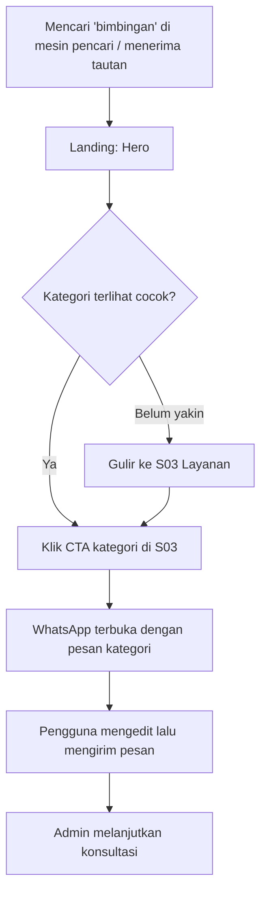
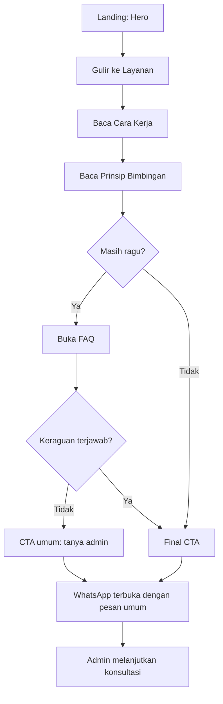
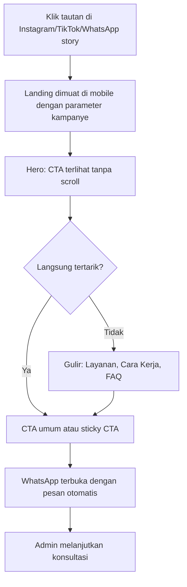

# PRD — Bimbing.in

| | |
|---|---|
| **Versi** | 0.1 (draft) |
| **Tanggal** | 25 Oktober 2026 |
| **Pemilik produk** | Damar |
| **Dokumen pendamping** | `design.md` (pedoman desain operasional) |
| **Status referensi** | Belum ada referensi yang diterima (lihat Lampiran A) |

**Konvensi penandaan di seluruh dokumen**

- `[ASUMSI]` = keputusan sementara yang belum divalidasi; boleh diubah.
- `[KONFIRMASI]` = butuh jawaban pemilik produk sebelum implementasi.
- `[PLACEHOLDER]` = konten atau aset sementara; **tidak boleh lolos ke produksi**.

---

## 1. Executive Summary

Bimbing.in adalah landing page statis untuk mempromosikan layanan bimbingan akademik bagi mahasiswa dan pelajar. Satu tujuan utama: **mengarahkan pengunjung yang cocok ke percakapan WhatsApp dengan admin**. Pemesanan, penjadwalan, dan pembayaran terjadi di luar website, secara manual.

Keputusan inti dokumen ini:

1. **Scope tetap sempit**: tanpa backend, database, login, atau pembayaran.
2. **Stack**: React + Vite, CSS biasa dengan design tokens, hosting statis. Alasan dan alternatifnya ada di bagian 15.
3. **Kepercayaan dibangun lewat transparansi**, bukan lewat klaim. Karena belum ada testimoni, statistik, atau profil mentor yang terverifikasi, halaman mengandalkan kejelasan layanan, proses yang terbuka, FAQ jujur, dan posisi yang tegas bahwa Bimbing.in **membimbing, bukan mengerjakan tugas**.
4. **CTA WhatsApp** memakai Click to Chat dengan pesan otomatis per kategori yang tetap bisa diedit pengguna.
5. Semua konten yang belum pasti (harga, mentor, jam operasional, metode bimbingan) ditandai dan tidak dikarang.

---

## 2. Product Overview

### 2.1 Identitas

- **Nama:** Bimbing.in
- **Tagline awal:** "Teman Belajar, Teman Bertumbuh."
- **Evaluasi tagline:** dipertahankan. Frasanya hangat, mudah diingat, dan selaras dengan nama (*bimbing-in* = "bimbing aku"). Kelemahannya: bersifat emosional dan belum menjelaskan *apa* layanannya. Karena itu tagline dipakai sebagai penanda merek (header/footer/meta), sedangkan **headline hero harus menjelaskan layanan secara eksplisit** (lihat bagian 8, S02).

### 2.2 Alur bisnis

```
Temukan Bimbing.in → pelajari layanan → pilih kategori → baca info relevan
→ klik CTA → WhatsApp terbuka dengan pesan otomatis → admin lanjut konsultasi & pemesanan (manual)
```

### 2.3 Scope MVP

**Termasuk:** landing page satu halaman, katalog layanan berbasis data, CTA WhatsApp (umum dan per kategori), FAQ accordion, responsif desktop/mobile, SEO dasar, deployment statis.

**Tidak termasuk (out of scope):** authentication, dashboard pengguna/mentor, backend API khusus, database pelanggan, booking otomatis, payment gateway, live chat internal, LMS, review dinamis, marketplace dengan registrasi mentor mandiri.

Penambahan di luar daftar ini hanya boleh masuk dengan alasan bisnis tertulis.

---

## 3. Problem Statement

> Seluruh poin di bawah adalah **hipotesis**. Belum ada riset atau data pelanggan yang mendukungnya.

**Masalah calon pelanggan**
- Mahasiswa/pelajar tertahan di materi atau proyek teknis dan tidak tahu harus bertanya ke mana.
- Sulit membedakan bimbingan yang benar-benar mendampingi dari jasa yang sekadar menawarkan "beres".

**Kebutuhan bisnis**
- Satu halaman yang menjelaskan layanan dengan jelas agar admin tidak mengulang penjelasan dasar di setiap chat.
- Saluran akuisisi yang mudah dibagikan di media sosial.

**Hambatan kepercayaan**
- Brand baru, belum ada testimoni atau rekam jejak publik.
- Kategori "jasa tugas" sering diasosiasikan dengan joki, sehingga pengunjung dan institusi bisa curiga.

**Hambatan proses konsultasi**
- Pengunjung tidak tahu apa yang perlu disiapkan sebelum chat (topik, deadline, tingkat kesulitan).
- Tanpa konteks, admin harus bertanya berulang, dan pengunjung bisa berhenti membalas.

---

## 4. Goals & Non-Goals

### 4.1 Goals

**Primer**
1. Memperkenalkan layanan Bimbing.in.
2. Menjelaskan cakupan layanan per kategori.
3. Membangun kepercayaan lewat transparansi.
4. Mengarahkan pengunjung ke WhatsApp.
5. Memberi pengalaman yang baik di desktop dan mobile.

**Sekunder**
1. Mendukung promosi media sosial (tautan mudah dibagikan, preview sosial rapi).
2. Mengukur interaksi pengunjung (klik CTA per kategori).
3. Struktur kode dan konten mudah dikembangkan.

### 4.2 Non-Goals

- Menutup transaksi di website.
- Menampilkan harga, mentor, testimoni, atau statistik sebelum datanya nyata.
- Menjadi platform multi-mentor.

### 4.3 Indikator keberhasilan awal `[ASUMSI]`

Target numerik sengaja tidak ditetapkan sebelum ada baseline. Yang diukur sejak awal:

- Rasio klik CTA WhatsApp terhadap sesi.
- Distribusi klik per kategori dan per penempatan CTA.
- Proporsi trafik mobile vs desktop.
- Dari sisi admin (manual): berapa chat masuk yang berlanjut ke pemesanan.

---

## 5. Target Audience & Personas

**Utama:** mahasiswa. **Sekunder:** pelajar SMA/SMK.

> Persona berikut dibuat dari kebutuhan yang masuk akal. **Semuanya `[ASUMSI]`** dan perlu divalidasi lewat wawancara singkat dengan 5–8 calon pengguna.

### Persona 1 — Mahasiswa semester awal yang kewalahan

- **Konteks:** membuka halaman dari Instagram/WhatsApp story teman, via ponsel, malam hari.
- **Kebutuhan utama:** memahami materi teknis (logika pemrograman, SQL) dengan penjelasan yang sabar.
- **Masalah:** merasa malu bertanya di kelas; materi dosen terlalu cepat.
- **Informasi yang dibutuhkan:** topik apa yang dibimbing, bentuk sesi, kira-kira biaya, apakah cocok untuk pemula.
- **Kekhawatiran:** biaya, dinilai "bodoh", takut ujung-ujungnya hanya dikerjakan orang lain.
- **Pemicu menghubungi admin:** bahasa yang tidak menghakimi, kategori yang jelas cocok, ajakan chat yang ringan ("ceritakan kebutuhanmu dulu").

### Persona 2 — Mahasiswa tingkat akhir dengan proyek/tugas akhir

- **Konteks:** mencari lewat Google atau rekomendasi teman, via laptop, mendekati deadline.
- **Kebutuhan utama:** pendamping untuk bagian teknis (desain database, analisis data, prototipe UI, perangkat IoT).
- **Masalah:** stuck di satu bagian spesifik, waktu terbatas.
- **Informasi yang dibutuhkan:** cakupan bimbingan, cara kerja, kecepatan respons, batas bantuan.
- **Kekhawatiran:** kualitas pembimbing, kerahasiaan topik, risiko akademik.
- **Pemicu:** kejelasan cakupan dan batas layanan, proses yang terstruktur, FAQ yang menjawab soal integritas akademik.

### Persona 3 — Pelajar SMA/SMK (sekunder)

- **Konteks:** proyek jurusan, lomba, atau tugas PKL; sering ditemani orang tua dalam keputusan membayar.
- **Kebutuhan utama:** pendampingan dasar pemrograman, desain, atau mikrokontroler.
- **Masalah:** bahan belajar sekolah terbatas.
- **Informasi yang dibutuhkan:** apakah menerima pelajar, tingkat materi, keamanan.
- **Kekhawatiran:** keamanan, kecocokan level, biaya (orang tua).
- **Pemicu:** pernyataan jelas bahwa pelajar diterima `[KONFIRMASI]`, bahasa yang sopan dan mudah dipahami orang tua.

---

## 6. Value Proposition & Positioning

### 6.1 Proposisi nilai

> **Pendampingan belajar yang jelas, langkah demi langkah, dan mudah dimulai lewat satu chat WhatsApp.**

Empat pilar, semuanya berupa *desain layanan*, bukan klaim keunggulan:

1. **Kejelasan layanan:** kategori, topik contoh, dan batas layanan dinyatakan terbuka.
2. **Kemudahan konsultasi:** satu klik ke WhatsApp dengan pesan yang sudah terisi konteks.
3. **Pendampingan belajar:** fokus pada pemahaman, bukan sekadar hasil akhir.
4. **Informasi transparan:** proses, FAQ, dan cara kerja dijelaskan sebelum pengunjung menghubungi.

### 6.2 Pembeda dari halaman promosi jasa biasa

- Halaman menjelaskan **proses dan batas layanan**, bukan hanya daftar jasa.
- CTA membawa **konteks kategori** sehingga admin tidak mulai dari nol.
- Pernyataan integritas akademik ditampilkan terang-terangan.

### 6.3 Keputusan produk: integritas akademik `[KONFIRMASI]`

Rekomendasi: Bimbing.in diposisikan sebagai **bimbingan** (menjelaskan konsep, mengarahkan langkah, mereview hasil pelanggan, membantu debugging), bukan **joki** (mengerjakan lalu diserahkan atas nama pelanggan). Alasannya: melindungi pelanggan dari sanksi, melindungi reputasi merek baru, dan menjadi pembeda yang bisa dipercaya.

Konsekuensi ke copywriting:
- Hindari kata: "joki", "terima beres", "dijamin A", "pasti lulus".
- Wajib ada pernyataan batas layanan di FAQ dan di section prinsip.

### 6.4 Klaim yang dilarang

Tidak boleh ada: angka pelanggan, rating, testimoni, logo partner, sertifikasi, kelulusan/nilai dijanjikan, atau superlatif ("terbaik", "nomor 1") sampai dapat dibuktikan.

---

## 7. Service Scope

### 7.1 Kategori awal (sekaligus data katalog)

Kategori belum tentu semuanya tersedia saat peluncuran `[KONFIRMASI]`. Struktur data dibuat agar kategori bisa ditambah, dihapus, atau disembunyikan tanpa mengubah komponen.

| ID | Nama | Deskripsi singkat (draft) | Contoh topik (draft) `[KONFIRMASI]` | Status |
|---|---|---|---|---|
| `programming` | Programming & Development | Pendampingan logika pemrograman dan pengembangan aplikasi | Dasar pemrograman, web, debugging, struktur proyek | aktif |
| `data` | Database & Data Analysis | Pendampingan perancangan database dan analisis data | Desain tabel & relasi, SQL, pembersihan dan analisis data | aktif |
| `uiux` | UI/UX Design | Pendampingan merancang antarmuka dan alur pengguna | Wireframe, prototipe, evaluasi usability | aktif |
| `iot` | IoT & Microcontroller | Pendampingan proyek perangkat dan mikrokontroler | Sensor, rangkaian dasar, pemrograman mikrokontroler | aktif |

### 7.2 Skema entri katalog

Setiap kategori memiliki: `id`, `name`, `shortDescription`, `topics[]`, `icon`, `waContext` (kata yang dimasukkan ke pesan WhatsApp), `isActive`, `order`. Harga **tidak** menjadi field di MVP.

### 7.3 Harga

Tidak ditampilkan di MVP. Setiap kartu menyatakan "Diskusikan kebutuhan dan biaya lewat WhatsApp" `[KONFIRMASI: apakah harga boleh ditampilkan?]`.

---

## 8. Information Architecture

### 8.1 Sitemap (satu halaman)

| Urutan | Section ID | Anchor | Nama |
|---|---|---|---|
| 1 | S01 | — | Navigation Bar |
| 2 | S02 | `#beranda` | Hero |
| 3 | S03 | `#layanan` | Service Categories |
| 4 | S04 | `#cara-kerja` | How It Works |
| 5 | S05 | `#prinsip` | Prinsip Bimbingan (gabungan Value Proposition + Why Choose) |
| 6 | S06 | `#mentor` | Mentor/Team (dinonaktifkan di MVP, flag) |
| 7 | S07 | `#faq` | FAQ |
| 8 | S08 | `#kontak` | Final CTA |
| 9 | S09 | — | Footer |

### 8.2 Keputusan struktur

- **Value Proposition digabung dengan Why Choose Bimbing.in** menjadi satu section (S05). Tanpa bukti sosial, dua section terpisah akan saling mengulang dan berisiko berisi klaim kosong. Value proposition disampaikan di hero; S05 menjelaskan *bagaimana* layanan bekerja.
- **Mentor/Team (S06) disembunyikan** lewat flag data. Section hanya aktif bila ada data mentor nyata dan izin menampilkannya.
- Urutan memprioritaskan: paham layanan → pilih kategori → paham proses → hilangkan keraguan → CTA akhir.

### 8.3 Spesifikasi section

#### S01 — Navigation Bar
- **Tujuan:** navigasi cepat dan CTA selalu terjangkau.
- **Informasi:** wordmark "Bimbing.in" `[PLACEHOLDER: logo final belum ada]`; tautan Layanan, Cara Kerja, Prinsip, FAQ; tombol "Konsultasi via WhatsApp".
- **Komponen:** `SiteHeader`, `MobileNavigation`, `WhatsAppButton`.
- **Urutan:** logo → tautan → CTA.
- **CTA:** WhatsApp umum (placement `header`).
- **Interaksi:** sticky; tautan anchor scroll ke section (menghormati `prefers-reduced-motion`); indikator section aktif `[ASUMSI: P2]`.
- **Desktop (≥768px):** tautan sebaris, CTA di kanan.
- **Mobile (<768px):** tombol menu (hamburger) membuka panel; CTA tetap tampil di dalam panel; Esc dan klik tautan menutup panel.
- **Acceptance criteria:**
  - Semua tautan anchor mendarat tepat di bawah header (tidak tertutup).
  - Panel mobile bisa dibuka/ditutup lewat keyboard; `aria-expanded` mencerminkan status.
  - Fokus tidak hilang saat panel menutup (kembali ke tombol menu).

#### S02 — Hero
- **Tujuan:** dalam 5 detik pengunjung tahu *apa* layanannya, *untuk siapa*, dan *apa langkah berikutnya*.
- **Informasi:** headline, subheadline, CTA utama, CTA sekunder, tagline sebagai eyebrow, satu visual pendukung.
- **Draft copy `[PLACEHOLDER]`:**
  - Eyebrow: "Teman Belajar, Teman Bertumbuh."
  - H1: "Bimbingan akademik yang jelas, langkah demi langkah."
  - Sub: "Pemrograman, database, analisis data, UI/UX, dan IoT. Ceritakan kebutuhanmu lewat WhatsApp, kami bantu kamu paham dan menyelesaikannya sendiri."
- **Komponen:** `HeroSection`, `WhatsAppButton` (primer), `Button` (sekunder "Lihat layanan" → `#layanan`).
- **Urutan:** eyebrow → H1 → sub → dua CTA → catatan kecil ("Konsultasi awal lewat chat, tanpa kewajiban memesan" `[KONFIRMASI]`) → visual.
- **CTA:** WhatsApp umum (`hero`).
- **Interaksi:** hover/focus pada tombol; tanpa animasi masuk yang menunda konten.
- **Desktop:** dua kolom (teks ± 7/12, visual ± 5/12).
- **Mobile:** satu kolom; teks dan CTA wajib terlihat tanpa scroll (above the fold) pada layar 360×640.
- **Acceptance criteria:**
  - H1 adalah satu-satunya `<h1>` di halaman.
  - CTA utama terlihat tanpa scroll di 360×640 dan 1366×768.
  - Visual tidak menggeser LCP lebih dari target (lihat NFR).

#### S03 — Service Categories
- **Tujuan:** membantu pengunjung menemukan kategori yang cocok dan memulai chat dengan konteks.
- **Informasi:** judul section, kalimat pengantar, kartu per kategori (ikon, nama, deskripsi, 2–4 contoh topik, CTA).
- **Komponen:** `ServicesSection`, `ServiceCard`, `WhatsAppButton`.
- **Urutan:** sesuai field `order` di data.
- **CTA:** WhatsApp per kategori (`service_card`), pesan memuat nama kategori.
- **Interaksi:** kartu tidak sepenuhnya clickable; hanya tombol di dalam kartu yang interaktif (hindari target ganda dan masalah aksesibilitas).
- **Desktop:** grid `auto-fit` (kolom ± 240px minimum), ideal 4 kolom pada 4 kategori.
- **Mobile:** satu kolom; tombol CTA lebar penuh.
- **Acceptance criteria:**
  - Menambah/menghapus kategori di data langsung tercermin tanpa edit komponen.
  - Kategori `isActive: false` tidak dirender.
  - Tiap kartu memiliki satu CTA dengan label yang menyebut kategori.

#### S04 — How It Works
- **Tujuan:** mengurangi ketidakpastian proses.
- **Informasi (draft `[KONFIRMASI]`, harus sesuai proses admin sebenarnya):**
  1. Pilih kategori dan ceritakan kebutuhanmu.
  2. Chat admin lewat WhatsApp.
  3. Sepakati lingkup, jadwal, dan biaya.
  4. Mulai sesi bimbingan.
- **Komponen:** `HowItWorksSection`.
- **Urutan:** langkah 1–4 berurutan, bernomor.
- **CTA:** WhatsApp umum di akhir section (opsional, `how_it_works`).
- **Interaksi:** statis.
- **Desktop:** 4 kolom horizontal dengan penanda urutan. **Mobile:** daftar vertikal bernomor.
- **Acceptance criteria:** urutan terbaca benar oleh screen reader (`<ol>`); langkah tidak menyiratkan fitur yang tidak ada (mis. "bayar online").

#### S05 — Prinsip Bimbingan
- **Tujuan:** menjelaskan cara Bimbing.in bekerja dan batas layanan tanpa klaim yang tak bisa dibuktikan.
- **Informasi (draft `[PLACEHOLDER]`):** 3–4 kartu, misalnya: "Membimbing, bukan mengerjakan", "Dimulai dari kebutuhanmu", "Penjelasan bertahap", "Informasi terbuka sejak awal".
- **Komponen:** `FeatureSection` + `FeatureCard`.
- **CTA:** tidak ada (hindari CTA berlebihan); tautan teks ke FAQ opsional.
- **Desktop:** grid 2×2 atau 4 kolom. **Mobile:** satu kolom.
- **Acceptance criteria:** setiap kartu memuat pernyataan tentang *cara kerja layanan*, bukan klaim hasil atau perbandingan dengan pesaing.

#### S06 — Mentor/Team *(nonaktif di MVP)*
- **Tujuan:** menampilkan pembimbing bila data nyata tersedia.
- **Syarat aktif:** nama, bidang, dan izin menampilkan profil; foto asli (bukan stok).
- **Acceptance criteria:** bila flag `showMentors` bernilai false, tidak ada markup, tautan nav, maupun ruang kosong yang tersisa.

#### S07 — FAQ
- **Tujuan:** menjawab keraguan sebelum chat.
- **Draft pertanyaan `[KONFIRMASI jawaban]`:**
  1. Apakah Bimbing.in mengerjakan tugas saya? *(jawab tegas: tidak, kami membimbing)*
  2. Bagaimana cara memulai?
  3. Berapa biaya bimbingan? *(dibahas saat konsultasi, atau jawaban lain sesuai keputusan)*
  4. Bimbingannya online atau tatap muka?
  5. Apakah menerima pelajar SMA/SMK?
  6. Kapan admin biasanya membalas? *(jam operasional)*
  7. Apakah data saya disimpan di website? *(tidak; percakapan terjadi di WhatsApp)*
- **Komponen:** `FAQSection`, `FAQItem`.
- **Interaksi:** accordion; satu terbuka pada satu waktu bila didukung browser.
- **Acceptance criteria:** bisa dioperasikan penuh dengan keyboard; konten tetap ada di DOM (terindeks); tidak ada jawaban yang menjanjikan hal di luar scope.

#### S08 — Final CTA
- **Tujuan:** menangkap pengunjung yang sudah membaca sampai bawah.
- **Informasi:** satu pesan penutup, CTA WhatsApp, catatan jam respons `[KONFIRMASI]`.
- **CTA:** WhatsApp umum (`final_cta`).
- **Desktop/Mobile:** blok kontras tinggi, satu CTA dominan.
- **Acceptance criteria:** hanya satu aksi utama; tombol tidak lebih kecil dari target sentuh minimum.

#### S09 — Footer
- **Informasi:** wordmark, tagline, tautan anchor, tautan WhatsApp, tautan media sosial `[KONFIRMASI]`, catatan hak cipta.
- **Interaksi:** tautan eksternal memakai `target="_blank"` dengan `rel="noopener noreferrer"`.
- **Acceptance criteria:** tidak ada tautan media sosial placeholder yang aktif; tautan eksternal menyebutkan tujuan.

#### Sticky CTA mobile (P1)
Tombol WhatsApp melayang di bawah layar mobile; muncul setelah hero keluar viewport, tersembunyi saat S08 terlihat agar tidak menumpuk dengan CTA akhir. Tidak menutupi konten footer.

---

## 9. User Flows

### Alur A — Pengunjung yang langsung mencari layanan



### Alur B — Pengunjung yang masih butuh informasi



### Alur C — Pengunjung dari tautan media sosial



Semua alur berakhir pada konsultasi WhatsApp.

---

## 10. Functional Requirements

Prioritas: **P0** wajib MVP, **P1** penting tapi dapat menyusul, **P2** opsional.

| ID | Feature | Description | User Story | Priority | Acceptance Criteria | Dependencies |
|---|---|---|---|---|---|---|
| FR-01 | Navigasi desktop | Header sticky dengan tautan anchor dan CTA | Sebagai pengunjung, saya ingin berpindah section dengan cepat | P0 | Tautan mendarat di section yang benar tanpa tertutup header | S01 |
| FR-02 | Navigasi responsif | Menu hamburger di <768px | Sebagai pengguna mobile, saya ingin menu yang mudah dijangkau | P0 | Dapat dibuka/ditutup via sentuh dan keyboard; `aria-expanded` akurat; Esc menutup | FR-01 |
| FR-03 | Anchor links | Scroll halus ke section, offset header | Sebagai pengunjung, saya ingin tidak kehilangan konteks saat berpindah | P0 | `scroll-margin-top` sesuai tinggi header; scroll halus dimatikan saat `prefers-reduced-motion` | FR-01 |
| FR-04 | Hero | Headline, sub, CTA, visual | Sebagai pengunjung baru, saya ingin langsung paham layanan | P0 | CTA tampak di 360×640 tanpa scroll; satu `<h1>` | S02 |
| FR-05 | Service catalog | Kartu dirender dari data | Sebagai pemilik, saya ingin ubah kategori tanpa edit komponen | P0 | Tambah/hapus/nonaktifkan entri data mengubah tampilan | `data/services` |
| FR-06 | CTA WhatsApp umum | Tombol dengan pesan umum | Sebagai pengunjung, saya ingin bertanya tanpa memilih kategori | P0 | Membuka WhatsApp dengan pesan umum; teks bisa diedit | FR-16 |
| FR-07 | CTA WhatsApp per kategori | Pesan memuat nama kategori | Sebagai pengunjung, saya ingin admin tahu kebutuhan saya sejak pesan pertama | P0 | Pesan memuat nama kategori yang diklik; karakter khusus ter-encode benar | FR-05, FR-16 |
| FR-08 | FAQ accordion | Pertanyaan dapat dibuka/ditutup | Sebagai pengunjung, saya ingin jawaban cepat | P0 | Keyboard (Enter/Space); satu terbuka sekaligus bila didukung; konten tetap ada di DOM | S07 |
| FR-09 | How It Works | Langkah bernomor | Sebagai pengunjung, saya ingin tahu prosesnya | P0 | `<ol>`; urutan benar | S04 |
| FR-10 | Prinsip Bimbingan | Kartu fitur | Sebagai pengunjung, saya ingin tahu batas dan cara kerja layanan | P0 | Tidak ada klaim tak terbukti; memuat pernyataan "membimbing, bukan mengerjakan" `[KONFIRMASI]` | S05 |
| FR-11 | Final CTA | Blok penutup | Sebagai pembaca sampai bawah, saya ingin langsung memulai | P0 | Satu CTA dominan | S08 |
| FR-12 | Footer & link eksternal | Tautan aman | Sebagai pengguna, saya ingin tautan yang aman | P0 | `rel="noopener noreferrer"` pada `_blank`; tanpa tautan placeholder aktif | S09 |
| FR-13 | Responsivitas | Layout adaptif | Sebagai pengguna di perangkat apa pun, saya ingin tampilan nyaman | P0 | Tidak ada scroll horizontal dari 320px hingga 1920px | design.md |
| FR-14 | Aksesibilitas | Semantik, keyboard, fokus, kontras | Sebagai pengguna dengan kebutuhan aksesibilitas, saya ingin dapat memakai semua fitur | P0 | Lolos checklist Lampiran B; kontras teks ≥ 4.5:1 | design.md |
| FR-15 | SEO metadata | Title, description, OG, favicon | Sebagai pemilik, saya ingin hasil pencarian dan preview bagus | P0 | Title & description unik; OG lengkap; favicon tampil | — |
| FR-16 | Konfigurasi WhatsApp terpusat | Nomor dan templat pesan di satu tempat | Sebagai pemilik, saya ingin ganti nomor di satu tempat | P0 | Mengubah nomor hanya di satu lokasi; nomor placeholder menggagalkan build/pengecekan | — |
| FR-17 | Analytics klik CTA | Event per CTA dan kategori | Sebagai pemilik, saya ingin tahu CTA mana yang efektif | P1 | Event terkirim dengan `placement` dan `category`; tidak mengirim data pribadi | FR-06, FR-07 |
| FR-18 | Sticky CTA mobile | Tombol melayang setelah hero | Sebagai pengguna mobile, saya ingin CTA selalu terjangkau | P1 | Muncul setelah hero; hilang di S08; tidak menutupi konten | FR-06 |
| FR-19 | Gambar OG | Gambar preview 1200×630 | Sebagai pemilik, saya ingin tautan terlihat menarik di media sosial | P1 | Preview benar di uji debugger platform | aset |
| FR-20 | Section Mentor | Profil mentor, dikendalikan flag | Sebagai pengunjung, saya ingin tahu siapa pembimbingnya | P2 | Tidak terender bila flag mati | data mentor nyata |
| FR-21 | Tag sumber di pesan WA | Menambahkan sumber kampanye ke pesan | Sebagai admin, saya ingin tahu asal chat | P2 | Pengguna melihat dan bisa menghapus tag sebelum mengirim | FR-06, kebijakan privasi |
| FR-22 | Sitemap & robots | File untuk mesin pencari | Sebagai pemilik, saya ingin halaman terindeks | P1 | `robots.txt` valid; sitemap berisi URL kanonik | domain |

---

## 11. Non-Functional Requirements

Semua angka adalah **target awal `[ASUMSI]`**, diverifikasi dan dikalibrasi saat pengujian.

| Kategori | Persyaratan | Cara verifikasi |
|---|---|---|
| **Performance** | LCP ≤ 2.5 s, CLS ≤ 0.1, INP ≤ 200 ms (profil mobile, jaringan 4G) | Lighthouse (mobile), PageSpeed Insights |
| | Skor Lighthouse Performance mobile ≥ 90 | Lighthouse |
| | JavaScript awal (gzip) sekecil mungkin; target ≤ 100 KB | Output `build`, analisis bundle |
| | Gambar hero ≤ 150 KB, format modern (AVIF/WebP) dengan fallback | Cek ukuran aset |
| | Font self-hosted, subset yang diperlukan, ≤ 2 berat selain variabel; `font-display: swap` | Network panel |
| | Gambar punya `width`/`height`; gambar di bawah fold `loading="lazy"` | Audit manual/Lighthouse |
| **Accessibility** | WCAG 2.2 AA sebagai target | Audit axe + uji manual |
| | HTML semantik (`header`, `nav`, `main`, `section`, `footer`), hierarki heading berurutan | Inspeksi outline |
| | Seluruh fitur dapat dipakai dengan keyboard; fokus terlihat | Uji keyboard manual |
| | Kontras teks ≥ 4.5:1 (teks besar ≥ 3:1), komponen UI ≥ 3:1 | Alat kontras |
| | Alt text bermakna; ilustrasi dekoratif `alt=""` | Review manual |
| | Target sentuh ≥ 44×44 px | Inspeksi |
| | Hormati `prefers-reduced-motion` | Uji pengaturan OS |
| **SEO** | Title (≤ ~60 karakter) dan meta description (≤ ~160) unik | Review |
| | Open Graph & Twitter Card lengkap, favicon | Debugger preview sosial |
| | Satu `<h1>`, heading berurutan, `lang="id"` | Inspeksi |
| | Konten utama ada di HTML hasil render (lihat 15.4) | Uji "view-source" & tool inspeksi |
| **Security & Privacy** | Tanpa penyimpanan data pribadi di website | Review kode |
| | Tanpa secret di frontend (nomor WhatsApp bukan secret, tapi tak boleh ada kunci API) | Review repo |
| | Tautan eksternal memakai `rel="noopener noreferrer"` | Review |
| | Bila analytics dipakai: jelaskan cookie/pelacakan di footer atau halaman privasi; pilih opsi tanpa cookie bila bisa | Review |
| | HTTPS wajib; header keamanan dasar dari hosting bila tersedia | Cek deployment |
| **Browser support** | Dua versi terakhir Chrome, Edge, Firefox, Safari (desktop & iOS), Samsung Internet `[ASUMSI]` | Uji manual + BrowserStack/perangkat nyata |
| | Viewport minimum 320px | Uji responsif |

---

## 12. WhatsApp Integration Specification

### 12.1 Format URL

```
https://wa.me/<NOMOR_INTERNASIONAL>?text=<PESAN_TER-ENCODE>
```

- **Nomor:** format internasional tanpa `+`, tanpa spasi/tanda hubung, tanpa nol di depan. Contoh pola: `62` + nomor tanpa 0 awal. **Nomor produksi tidak ditulis di dokumen ini** `[KONFIRMASI]`.
- **Pesan:** di-encode dengan URL-encoding (spasi, baris baru `%0A`, tanda baca, emoji).

### 12.2 Konfigurasi

- Satu sumber kebenaran untuk nomor: `src/config/site.js`, dengan nilai dari variabel lingkungan build (mis. `VITE_WA_NUMBER`). Nomor adalah informasi publik, bukan secret.
- Templat pesan di `src/config/site.js` atau `src/utils/whatsapp.js`; konteks kategori dari `data/services`.
- **Penjagaan:** bila nomor kosong atau masih placeholder, build/pengecekan memberi peringatan keras dan tombol tidak boleh mengarah ke nomor palsu.

### 12.3 Format pesan (draft `[PLACEHOLDER]`)

**Umum:**
```
Halo Bimbing.in, saya ingin konsultasi soal bimbingan belajar.
Topik / mata kuliah:
Deadline (jika ada):
```

**Per kategori:**
```
Halo Bimbing.in, saya ingin konsultasi bimbingan untuk kategori {Nama Kategori}.
Topik / mata kuliah:
Deadline (jika ada):
```

Baris kosong "Topik" dan "Deadline" mengisi kebutuhan konteks admin dan bisa dihapus atau diisi pengguna sebelum mengirim.

### 12.4 Perilaku tombol

- Tombol adalah tautan (`<a>`) dengan `href` penuh, bukan handler JavaScript yang membuka jendela. Ini menjaga perilaku bawaan browser, dapat dibuka di tab baru, dan tetap berfungsi bila JS gagal.
- `target="_blank"` dengan `rel="noopener noreferrer"`.
- Label menjelaskan aksi: "Konsultasi via WhatsApp"; di kartu kategori: "Konsultasi {Kategori}".
- Ikon WhatsApp bersifat dekoratif (`aria-hidden`).
- Event analytics (bila aktif) dikirim saat klik tanpa menunda navigasi.

### 12.5 Edge cases

| Situasi | Perilaku |
|---|---|
| Desktop tanpa aplikasi WhatsApp | `wa.me` mengarahkan ke WhatsApp Web / halaman unduh |
| Mobile tanpa WhatsApp terpasang | Halaman unduh/tautan alternatif WhatsApp |
| Nama kategori berisi `&` | Harus ter-encode agar pesan tidak terpotong (mis. "Database & Data Analysis") |
| Pesan terlalu panjang | Jaga templat pendek; hindari menyalin teks panjang |
| Popup blocker | Tidak relevan karena memakai tautan biasa |
| Nomor belum dikonfigurasi | Peringatan build; jangan tampilkan tombol aktif ke nomor acak |
| Parameter kampanye tidak ada | Pesan memakai templat standar tanpa tag sumber |

### 12.6 Acceptance criteria

- Klik tiap CTA membuka percakapan dengan nomor dari konfigurasi dan pesan yang sesuai (umum atau kategori).
- Pesan muncul utuh dan terbaca benar (tidak ada karakter rusak) di Android, iOS, dan desktop.
- Mengubah nomor di satu tempat memperbarui seluruh CTA.
- Pengguna dapat mengedit pesan sebelum mengirim.

---

## 13. Analytics & Conversion

**Prinsip:** ukur secukupnya. Analytics dimasukkan hanya sebagai **P1** karena manfaatnya jelas (tahu CTA mana yang dipakai) namun bukan syarat peluncuran.

**Yang diukur**

| Metrik | Cara |
|---|---|
| Page views, sumber trafik, kategori perangkat | Bawaan tool analytics |
| Parameter kampanye | `utm_source`, `utm_medium`, `utm_campaign` pada tautan promosi |
| Klik CTA | Event `wa_cta_click` dengan properti `placement` (`header`, `hero`, `service_card`, `how_it_works`, `final_cta`, `sticky`, `footer`) dan `category` (`general` atau id kategori) |
| Interaksi FAQ | Event `faq_toggle` (P2) |

**Pembeda penting:** *klik WhatsApp ≠ pemesanan*. Website hanya bisa mengukur niat (klik). Konversi nyata (chat berlanjut → pemesanan) dicatat **manual oleh admin** (mis. mencatat sumber saat bertanya "tahu Bimbing.in dari mana?").

**Pertimbangan privasi**
- Pilih tool yang tidak memakai cookie dan tidak membuat profil lintas situs (mis. kategori seperti Plausible/Umami/Cloudflare Web Analytics; pilihan final `[KONFIRMASI]`).
- Jangan mengirim konten pesan, nomor, atau data pribadi ke analytics.
- Bila tool memakai cookie, tampilkan pemberitahuan dan pertimbangkan consent.
- Pencatatan sumber di pesan WhatsApp (FR-21) bersifat opsional dan harus transparan bagi pengguna.

---

## 14. SEO & Deployment

### 14.1 SEO

- `lang="id"`, title dan description berbahasa Indonesia, kata kunci alami (bimbingan, mahasiswa, kategori layanan), tidak diulang-ulang.
- Open Graph + Twitter Card, gambar 1200×630 (aset belum tersedia → `[PLACEHOLDER]`).
- URL kanonik, favicon, `robots.txt`, sitemap sederhana (satu URL).
- Data terstruktur (mis. `Organization`/`Service`) hanya bila datanya nyata; tidak ada rating atau ulasan palsu.

### 14.2 Hosting & domain (konseptual)

- **Hosting statis** dengan HTTPS otomatis dan deploy dari repositori Git (opsi: Vercel, Netlify, Cloudflare Pages, GitHub Pages). Keputusan akhir `[KONFIRMASI]`.
- **Domain kustom** belum dibeli `[KONFIRMASI]`; sementara gunakan subdomain bawaan hosting.
- **Konfigurasi lingkungan:** nomor WhatsApp dan ID analytics lewat variabel lingkungan build.

### 14.3 Alur build & deploy (konseptual)

1. Developer mendorong perubahan ke repositori Git.
2. Layanan hosting menjalankan build produksi.
3. Pemeriksaan otomatis (peringatan placeholder, lint) berjalan sebelum rilis.
4. Hasil statis dipublikasikan ke CDN dengan HTTPS.
5. Preview deployment per cabang dipakai untuk uji sebelum merge ke produksi.
6. Setelah rilis: uji ulang CTA WhatsApp, preview sosial, dan Lighthouse.

### 14.4 Catatan SEO untuk SPA React

Karena satu halaman dan metadata ditulis di `index.html` statis, mesin pencari dan crawler pratinjau sosial membaca meta tag tanpa menjalankan JavaScript. Konten utama dirender oleh JS; Google umumnya mampu mengindeksnya, tetapi ini risiko kecil yang diverifikasi setelah deploy. Jika hasil indeks buruk, opsi mitigasi: pre-render saat build atau pindah ke Astro (bagian 15).

---

## 15. Technical Architecture

### 15.1 Perbandingan stack

| Kriteria | Vanilla HTML/CSS/JS | React + Vite | Next.js | Astro *(opsi tambahan)* |
|---|---|---|---|---|
| Kompleksitas produk | Cukup | Sedikit berlebih tapi wajar | Berlebihan | Cukup |
| Kemudahan implementasi | Sangat mudah | Mudah | Sedang | Mudah |
| Performa | Terbaik (tanpa framework) | Baik; ada biaya runtime React | Baik; lebih berat | Sangat baik (JS minimal) |
| SEO | Sangat baik | Baik untuk satu halaman (meta statis) | Sangat baik (SSR/SSG) | Sangat baik (HTML statis) |
| Pengelolaan komponen | Lemah (duplikasi markup) | Kuat | Kuat | Kuat |
| Deployment | Paling mudah | Mudah (statis) | Mudah, tapi fitur server tak terpakai | Mudah (statis) |
| Pemeliharaan | Menurun saat konten tumbuh | Baik | Baik, kompleksitas lebih tinggi | Baik |
| Pengembangan mendatang | Terbatas | Fleksibel (bisa tumbuh ke app) | Sangat fleksibel | Fleksibel |

### 15.2 Rekomendasi: **React + Vite**

Alasan:
- Konten berbasis data (katalog, FAQ, langkah) cocok dipecah menjadi komponen yang dirender dari data.
- Vite memberi build statis cepat tanpa server; sesuai constraint "tanpa backend".
- Jalur pertumbuhan terbuka bila suatu hari butuh fitur interaktif.
- Next.js ditolak: fitur server-side (SSR, API route, middleware) **tidak diperlukan** untuk landing page statis.

Catatan jujur:
- **Vanilla** sebenarnya cukup untuk MVP ini dan lebih ringan. React dipilih demi keteraturan komponen dan data, **dengan asumsi pemilik nyaman memakai React `[ASUMSI]`**. Bila tidak, Vanilla atau Astro lebih masuk akal.
- **Astro** adalah pesaing kuat (komponen + nol JS secara bawaan + HTML statis). Jika hasil uji performa atau indeksasi React kurang memuaskan, migrasi ke Astro adalah langkah yang jelas.

Tidak ada React Router (satu halaman, tanpa rute). Versi Node, React, dan Vite diverifikasi saat memulai implementasi; jangan mengasumsikan versi terbaru.

### 15.3 Constraints arsitektur

Tidak ada: backend khusus, database, authentication, API server, payment processing, atau state management library. State lokal cukup memakai hook bawaan React (mis. status menu mobile).

### 15.4 Strategi CSS

| Opsi | Penilaian |
|---|---|
| **Plain CSS + design tokens (CSS custom properties)** | **Dipilih.** Skala kecil, token memetakan langsung ke `design.md`, tanpa konfigurasi tambahan, dan mudah dibaca AI assistant |
| CSS Modules | Berguna untuk isolasi, tetapi menambah kerumitan untuk ±12 komponen |
| Tailwind CSS | Cepat, tetapi menambah konfigurasi dan token ganda; layak bila referensi `design.md` yang kamu berikan berbasis Tailwind (prioritas referensi berlaku) |

Aturan: satu sistem styling saja. File token global + file CSS per komponen (berdampingan dengan komponen), dengan prefiks kelas `bi-`.

### 15.5 Library pendukung

| Kebutuhan | Keputusan | Alasan |
|---|---|---|
| Ikon | Set SVG inline lokal (±10 ikon) | Ikon WhatsApp merek tidak tersedia di banyak pustaka ikon; menghindari dependency demi beberapa ikon |
| Font | Plus Jakarta Sans, self-hosted (mis. via paket Fontsource) `[verifikasi ketersediaan & versi saat implementasi]` | Tanpa permintaan pihak ketiga; performa dan privasi lebih baik |
| Animasi | Tidak ada library; transisi CSS saja | Efek dekoratif sederhana tidak butuh dependency |
| Komponen UI | Tidak ada | Komponen sedikit dan sederhana |
| Accordion FAQ | Elemen native `<details>/<summary>` dengan atribut `name` untuk perilaku eksklusif | Aksesibilitas bawaan, tanpa JS; browser yang belum mendukung `name` tetap berfungsi (beberapa item terbuka sekaligus) |
| Analytics | Skrip tool pilihan, bukan paket npm (P1) | Lihat bagian 13 |

---

## 16. Project Structure

```
bimbing-in/
├── docs/
│   ├── PRD.md
│   └── design.md
├── public/
│   ├── favicon.*            # [PLACEHOLDER] aset belum ada
│   ├── og-image.*           # [PLACEHOLDER] 1200×630
│   ├── robots.txt
│   └── sitemap.xml
├── index.html               # meta tag statis (title, OG, lang="id")
├── .env.example             # VITE_WA_NUMBER=, ID analytics
└── src/
    ├── assets/              # gambar/ilustrasi hasil optimasi
    ├── components/
    │   ├── layout/          # SiteHeader, MobileNavigation, SiteFooter
    │   ├── sections/        # Hero, Services, HowItWorks, Principles, Mentor, FAQ, FinalCTA
    │   └── ui/              # Button, WhatsAppButton, Icon, Section, StickyCTA
    ├── config/
    │   └── site.js          # nama, tagline, nomor WA, flag fitur, URL sosial
    ├── data/
    │   ├── services.js      # katalog kategori
    │   ├── faq.js
    │   ├── steps.js
    │   └── principles.js
    ├── styles/
    │   ├── tokens.css       # design tokens
    │   └── base.css         # reset, tipografi dasar, utilitas minimal
    ├── utils/
    │   ├── whatsapp.js      # pembuat URL & encoding pesan
    │   └── analytics.js     # pembungkus event (no-op bila tidak aktif)
    ├── App.jsx
    └── main.jsx
```

**Tanggung jawab dan keputusan**

- `config/` — nilai situs yang berubah jarang (nomor, tagline, flag `showMentors`). **Lokasi konfigurasi WhatsApp.**
- `data/` — konten terpisah dari tampilan. **Lokasi data kategori layanan.**
- `styles/tokens.css` — **lokasi design tokens**; satu-satunya tempat nilai warna/spacing/tipografi didefinisikan.
- `components/ui/` — **komponen reusable**; `sections/` hanya merakit komponen dan data.
- `utils/` — logika murni tanpa UI, mudah diuji.
- `docs/` — **lokasi dokumentasi**.
- **Aset:** gambar dioptimasi sebelum masuk repo; nama berkas deskriptif; tidak ada referensi ke berkas yang belum ada.
- **Folder `hooks/` sengaja tidak dibuat** karena belum ada hook reusable; tambahkan hanya bila muncul kebutuhan nyata.

---

## 17. Component Architecture

| Komponen | Tanggung jawab | Props / data | Berhubungan dengan | Interaksi | Responsif | Aksesibilitas |
|---|---|---|---|---|---|---|
| `Section` (ui) | Pembungkus: container, `id`, heading, spacing | `id`, `title`, `intro`, `tone` (`default`/`subtle`/`dark`), `children` | Semua section | — | Padding section 64→96px | `aria-labelledby` ke heading |
| `Button` (ui) | Tombol/tautan bergaya | `variant` (`primary`/`secondary`/`ghost`/`whatsapp`), `size`, `as`, `href`, `children` | Semua CTA | Hover, focus, active | Lebar penuh opsional di mobile | Tautan = `<a>`, aksi = `<button>`; fokus terlihat |
| `WhatsAppButton` (ui) | Membangun `href` WA dan memasang event analytics | `category?`, `placement`, `label?`, `variant`, `size` | `Button`, `utils/whatsapp`, `utils/analytics` | Klik → buka WA di tab baru | Sama dengan `Button` | `rel`, label jelas, ikon `aria-hidden` |
| `Icon` (ui) | Ikon SVG inline | `name`, `size`, `decorative` | Kartu, tombol | — | — | Dekoratif `aria-hidden`; bermakna diberi label |
| `StickyCTA` (ui, P1) | CTA melayang mobile | — | `WhatsAppButton`, sentinel hero/S08 | Muncul/hilang berdasarkan posisi scroll | Hanya <768px | Tidak menutupi fokus/konten; `aria-hidden` saat tersembunyi |
| `SiteHeader` | Header sticky, nav, CTA | `config`, daftar tautan | `MobileNavigation`, `WhatsAppButton` | Scroll anchor | Pindah ke hamburger <768px | `nav` berlabel; skip link ke `main` |
| `MobileNavigation` | Panel menu mobile | `links`, `isOpen`, `onClose` | `SiteHeader` | Buka/tutup; Esc; klik tautan | Hanya <768px | `aria-expanded`, `aria-controls`; fokus dikelola |
| `HeroSection` | Section S02 | copy dari config/data | `WhatsAppButton`, `Button` | CTA | 1→2 kolom di ≥1024px | `<h1>` tunggal; visual dekoratif `alt=""` |
| `ServicesSection` | Section S03, memetakan data | `services[]` aktif | `ServiceCard` | — | Grid `auto-fit` | `<ul>` daftar kartu |
| `ServiceCard` | Satu kategori | `service` | `WhatsAppButton`, `Icon` | CTA saja | Tombol lebar penuh di mobile | Heading `h3`; label CTA menyebut kategori |
| `HowItWorksSection` | Section S04 | `steps[]` | — | — | Vertikal → horizontal | `<ol>` |
| `FeatureSection` / `FeatureCard` | Section S05 | `principles[]` | `Icon` | — | 1→2/4 kolom | Heading hierarkis |
| `MentorSection` | Section S06 (flag) | `mentors[]` | — | — | Grid | Foto dengan alt bermakna |
| `FAQSection` / `FAQItem` | Section S07 | `faqs[]` | — | Buka/tutup | Satu kolom | `<details>/<summary>`; fokus terlihat |
| `FinalCTA` | Section S08 | copy | `WhatsAppButton` | CTA | Blok penuh | Kontras tinggi |
| `SiteFooter` | S09 | `config` | — | Tautan | 1→multi kolom | `footer`; tautan eksternal aman |

Prinsip: komponen `sections/` boleh bergantung pada `ui/`, tidak sebaliknya. Tidak ada komponen yang memuat seluruh halaman; elemen HTML kecil tidak dipecah tanpa alasan.

---

## 18. Content & Asset Inventory

### 18.1 Konten

| Item | Status |
|---|---|
| Nama produk, tagline awal | **Diketahui** |
| Alur bisnis, scope, daftar kategori awal | **Diketahui** |
| Nomor WhatsApp admin | **Perlu konfirmasi** |
| Daftar kategori final yang tersedia saat peluncuran | **Perlu konfirmasi** |
| Contoh topik per kategori | **Perlu konfirmasi** |
| Proses pemesanan sebenarnya (untuk S04) | **Perlu konfirmasi** |
| Jawaban FAQ (biaya, metode, jam respons, jenjang) | **Perlu konfirmasi** |
| Kebijakan integritas akademik | **Perlu konfirmasi** |
| Harga tampil atau tidak | **Perlu konfirmasi** |
| Data mentor + izin tampil | **Opsional/perlu konfirmasi** |
| Tautan media sosial | **Opsional/perlu konfirmasi** |
| Testimoni | **Tidak ada** — tidak dibuat |

### 18.2 Aset

| Identifier | Fungsi | Section | Dimensi/rasio disarankan | Format | Status |
|---|---|---|---|---|---|
| `logo-wordmark` | Identitas merek | S01, S09 | Vektor | SVG | Perlu dibuat `[PLACEHOLDER: teks sementara]` |
| `favicon` | Tab browser | — | 32×32, 180×180, SVG | SVG/PNG | Perlu dibuat |
| `og-image` | Preview sosial | meta | 1200×630 | PNG/JPG | Perlu dibuat |
| `hero-visual` | Pendukung hero | S02 | 4:3 atau 1:1; lebar ≤ 960px | AVIF/WebP + fallback, atau SVG | Perlu dibuat/dicari `[PLACEHOLDER]` |
| `icon-set` | Ikon kategori & UI | S03, S05, S01 | 24px, stroke konsisten | SVG inline | Perlu dibuat/dipilih |
| `icon-whatsapp` | Ikon CTA | CTA | 20–24px | SVG inline | Perlu dibuat |
| `mentor-photos` | Foto pembimbing | S06 | 1:1 | WebP | Opsional, hanya foto asli |

Tidak ada nama berkas fiktif yang dirujuk di kode sebelum aset benar-benar ada.

---

## 19. Testing Plan

| Area | Metode | Alat |
|---|---|---|
| CTA WhatsApp | Uji klik tiap CTA di Android, iOS, desktop; cek nomor, pesan, encoding (`&`, spasi, baris baru) | Perangkat nyata |
| Responsivitas | Uji di 320, 360, 390, 768, 1024, 1280, 1920px; tidak ada scroll horizontal | DevTools + perangkat nyata |
| Aksesibilitas otomatis | Audit skor dan pelanggaran | axe DevTools, Lighthouse |
| Aksesibilitas manual | Navigasi keyboard penuh, fokus terlihat, uji screen reader dasar (TalkBack/VoiceOver/NVDA), zoom 200% | Manual |
| Performa | LCP/CLS/INP mobile | Lighthouse, PageSpeed Insights |
| SEO & sosial | Meta, preview OG/Twitter, indeks | Debugger platform, Search Console |
| Lintas browser | Browser target di 2 versi terakhir | Manual/BrowserStack |
| Konten | Tidak ada placeholder, klaim, atau tautan palsu di produksi | Checklist Lampiran B |
| Regresi | Ulangi daftar inti setelah perubahan konten/nomor | Checklist |

---

## 20. Implementation Roadmap

| # | Fase | Tujuan | Aktivitas | Output | Dependensi | Acceptance criteria | Risiko |
|---|---|---|---|---|---|---|---|
| 1 | Requirement validation | Menutup Open Questions kritis | Jawab daftar bagian 22; wawancara singkat calon pengguna | PRD v1.0 | — | Semua `[KONFIRMASI]` P0 terjawab | Jawaban tertunda |
| 2 | Reference analysis | Menetapkan arah visual | Kirim referensi; analisis; tetapkan referensi utama | Lampiran A terisi | Fase 1 paralel | Tiap aspek punya referensi utama | Referensi saling bertentangan |
| 3 | Information architecture | Mengunci struktur & konten | Finalisasi section, copy draf, data katalog | Struktur final + copy v1 | 1 | Setiap section punya tujuan dan CTA | Copy mengandung klaim |
| 4 | Wireframing | Menguji alur | Wireframe mobile-first, lalu desktop | Wireframe | 3 | Alur A/B/C berujung ke CTA | Terlalu cepat ke visual |
| 5 | Design system & design.md | Mengunci token & komponen | Revisi token berdasarkan referensi | `design.md` v1.0 | 2, 4 | Token & kontras terverifikasi | Perubahan setelah coding |
| 6 | UI specification | Detail per komponen | Spesifikasi state & responsif | Spesifikasi komponen | 5 | Semua state terdokumentasi | Spesifikasi ambigu |
| 7 | Frontend development | Membangun | Setup, token, komponen, data, WhatsApp util | Situs berjalan | 5, 6 | Semua FR P0 lulus | Scope creep |
| 8 | Responsive & accessibility testing | Memastikan inklusif | Uji sesuai bagian 19 | Daftar bug & perbaikan | 7 | Checklist aksesibilitas lulus | Ditemukan masalah kontras |
| 9 | Performance & SEO optimization | Mencapai target NFR | Optimasi gambar/font, meta, sitemap | Laporan Lighthouse | 8 | Target performa tercapai | Aset berat |
| 10 | Deployment | Rilis | Hosting, HTTPS, domain, uji akhir | Situs live | 9 | CTA & preview berfungsi di produksi | Nomor/domain belum siap |

---

## 21. Risks

| Risiko | Dampak | Mitigasi |
|---|---|---|
| Layanan disalahpahami sebagai joki | Reputasi, risiko pelanggan | Pernyataan batas layanan di hero/FAQ/prinsip; hindari kosakata joki |
| Belum ada social proof | Kepercayaan rendah | Transparansi proses; tambah testimoni nyata (dengan izin) setelah ada |
| Placeholder lolos ke produksi | Kredibilitas rusak | Pengecekan build + checklist rilis |
| Nomor WhatsApp salah | Konversi nol | Konfigurasi satu tempat + uji klik pra-rilis |
| Respons admin lambat | Klik tidak jadi konversi | Cantumkan jam operasional realistis; sistem balasan cepat |
| Kontras/aksesibilitas | Pengguna terhambat | Audit sejak token; perbaiki sebelum coding komponen |
| Performa mobile buruk (gambar/font) | Trafik sosial hilang | Anggaran aset di NFR, uji berkala |
| Scope creep (login, booking) | Proyek molor | Pagar scope di bagian 2.3 |
| Pelacakan melanggar privasi | Kepercayaan, kepatuhan | Analytics tanpa cookie, tanpa data pribadi |
| Mentor tidak tersedia untuk kategori terpajang | Janji tak terpenuhi | Flag `isActive` per kategori; hanya tampilkan yang siap |
| SEO SPA kurang optimal | Trafik organik rendah | Verifikasi indeks; pre-render atau migrasi ke Astro |

---

## 22. Open Questions

**Kritis (P0, blokir implementasi)**
1. Nomor WhatsApp admin produksi?
2. Kategori mana yang benar-benar tersedia saat peluncuran?
3. Bagaimana proses pemesanan sebenarnya (untuk S04 dan FAQ)?
4. Apakah posisi "membimbing, bukan mengerjakan" disetujui sebagai kebijakan resmi?
5. Referensi desain: URL, screenshot, atau `design.md` mana yang menjadi acuan utama?

**Penting (P1)**
6. Apakah harga boleh ditampilkan (kisaran atau "mulai dari")?
7. Jam operasional dan perkiraan waktu balas admin?
8. Bimbingan online, tatap muka, atau keduanya?
9. Apakah pelajar SMA/SMK diterima, dan batas materi?
10. Logo/wordmark: sudah ada atau dibuat baru?
11. Tool analytics pilihan, dan apakah mau mulai dari MVP?
12. Hosting dan domain yang akan dipakai?

**Opsional (P2)**
13. Data mentor dan izin menampilkan profil?
14. Akun media sosial yang boleh ditautkan?
15. Apakah tagline dipertahankan setelah uji copy dengan calon pengguna?
16. Apakah nyaman memakai React `[menentukan stack]`?

---

## 23. MVP Checklist

- [ ] Semua FR P0 terpenuhi (bagian 10).
- [ ] Nomor WhatsApp produksi terkonfigurasi dan diuji.
- [ ] Setiap CTA membuka percakapan dengan pesan yang benar.
- [ ] Tidak ada placeholder, testimoni, statistik, atau tautan palsu di produksi.
- [ ] Kategori aktif sesuai kenyataan layanan.
- [ ] FAQ menjawab: integritas akademik, cara memulai, biaya, metode, jam respons.
- [ ] Responsif dari 320px, tanpa scroll horizontal.
- [ ] Navigasi keyboard penuh dan fokus terlihat.
- [ ] Kontras teks memenuhi 4.5:1.
- [ ] Title, description, OG, favicon terpasang.
- [ ] HTTPS aktif; deploy dari repositori.
- [ ] Skor Lighthouse mobile memenuhi target NFR.
- [ ] Uji lintas browser target lulus.

---

## Lampiran A — Reference Analysis

### A.1 Status

**Belum ada referensi yang diterima** pada tahap ini (tidak ada URL, screenshot, atau berkas `design.md` yang dilampirkan). Sesuai ketentuan, tidak ada isi referensi yang dikarang dan analisis visual belum dilakukan.

| Referensi | Status |
|---|---|
| URL website | Belum diberikan |
| Screenshot desain | Belum diberikan |
| `design.md` acuan | Belum diberikan |
| Referensi komponen UI / framework | Belum diberikan |
| Referensi branding | Belum diberikan |

### A.2 Keputusan sementara

Token, palet, dan tipografi di `design.md` adalah **arahan default berbasis praktik UX untuk landing page jasa edukasi**, dan **ditandai sementara**. Begitu referensi diterima, token yang bertentangan diganti sesuai prioritas di A.4.

### A.3 Template analisis per referensi (diisi saat referensi tiba)

Untuk tiap referensi: elemen relevan → layout/hierarki → tipografi → warna → spacing → navigasi → komponen & interaksi → **diadaptasi** → **tidak cocok** → konflik dengan referensi lain → aspek yang dijadikan acuan utama.

### A.4 Aturan prioritas bila referensi bertentangan

1. Kebutuhan produk dan tujuan bisnis Bimbing.in.
2. Persyaratan eksplisit dari pemilik.
3. `design.md` yang ditetapkan sebagai acuan.
4. Referensi visual yang diberikan.
5. Rekomendasi profesional UX/frontend.

Penetapan eksplisit pemilik ("referensi X adalah acuan utama untuk tipografi") mengalahkan urutan di atas untuk aspek tersebut. Referensi dipakai untuk **prinsip**, bukan disalin mentah.

---

## Lampiran B — Implementation Checklist

**Konten**
- [ ] Tidak ada testimoni, logo partner, foto mentor, atau angka fiktif
- [ ] Tidak ada kata "joki", "dijamin", "pasti lulus"
- [ ] Semua `[PLACEHOLDER]` dan `[KONFIRMASI]` sudah diselesaikan
- [ ] Pernyataan batas layanan tampil di S05 dan FAQ

**WhatsApp**
- [ ] Nomor berformat internasional benar, dari satu konfigurasi
- [ ] Pesan umum dan per kategori terbaca benar (Android, iOS, desktop)
- [ ] `&` dan karakter khusus ter-encode
- [ ] `target="_blank"` + `rel="noopener noreferrer"`

**Desain (merujuk `design.md`)**
- [ ] Hanya memakai token; tidak ada nilai warna/spacing "liar"
- [ ] Semua state tombol dan tautan terdokumentasi dan diimplementasi
- [ ] Hierarki visual hero jelas; satu aksi utama per section

**Aksesibilitas**
- [ ] Satu `<h1>`, heading berurutan
- [ ] Skip link, landmark semantik
- [ ] Fokus terlihat; keyboard mencakup menu mobile dan FAQ
- [ ] Kontras terverifikasi dengan alat
- [ ] Alt text/`alt=""` tepat; ikon dekoratif `aria-hidden`
- [ ] `prefers-reduced-motion` dihormati
- [ ] Target sentuh ≥ 44px

**Performa & SEO**
- [ ] Gambar dioptimasi, berdimensi, lazy-load di bawah fold
- [ ] Font self-hosted, `font-display: swap`
- [ ] Meta, OG, Twitter Card, favicon, canonical, sitemap, robots
- [ ] Lighthouse mobile memenuhi target

**Keamanan & privasi**
- [ ] Tidak ada secret/kunci di repositori
- [ ] Tidak ada penyimpanan data pribadi
- [ ] Analytics (bila ada) dijelaskan dan tanpa data pribadi

**Deployment**
- [ ] HTTPS aktif, domain terkonfigurasi
- [ ] Uji akhir di produksi: CTA, preview sosial, responsif

---

## Lampiran C — Quality Control (pemeriksaan dokumen)

| Pemeriksaan | Hasil |
|---|---|
| PRD, `design.md`, dan arsitektur teknis konsisten (token, komponen, breakpoint, struktur folder) | Ya, dengan token bersifat sementara menunggu referensi |
| Semua fitur sesuai scope landing page | Ya; fitur di luar scope tercatat di 2.3 |
| Setiap CTA memiliki tujuan jelas | Ya (WhatsApp umum/kategori, sekunder anchor) |
| Desktop dan mobile diperhitungkan | Ya, per section dan per komponen |
| Keputusan teknis beralasan | Ya (bagian 15) |
| Tidak ada dependency tak perlu | Ya; tanpa library animasi/komponen/ikon |
| Tidak ada klaim bisnis karangan | Ya; copy ditandai draft, tanpa angka/testimoni |
| Placeholder berlabel | Ya |
| Acceptance criteria dapat diuji | Ya |
| Dapat dipakai sebagai acuan coding | Ya, setelah Open Questions P0 dijawab |
